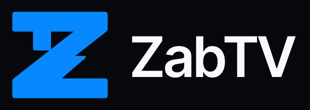

<p align="center">
  
</p>

<h1 align="center">ZabTV</h1>

<p align="center">
  Reproductor de listas IPTV para Android TV / Fire TV y móvil.<br />
  Tú pones la lista. ZabTV pone la experiencia.
</p>

<p align="center">
  
  
  
</p>

> **La app no incluye, aloja ni distribuye ningún contenido.** El usuario aporta
> sus propias listas (M3U) o cuentas (Xtream). Sin lista propia, la app no muestra nada.

## Características

- 📺 **Doble interfaz**: Android TV (sidebar + safe area) y móvil (barra inferior).
- 📋 **Listas M3U y cuentas Xtream**, con navegador local de `.m3u` en Fire TV.
- 🗓️ **Guía EPG (XMLTV)** con ventana horaria y zona horaria correctas.
- ⭐ **Favoritos que sobreviven reimports** (clave estable por canal).
- ▶️ **Reproductor Media3** + apertura en reproductores externos y AceStream.
- 🔒 **Privacidad**: sin telemetría, sin WebView, credenciales cifradas en el dispositivo.

## Compilar y probar

Requisitos: Android Studio (AGP 9.5.0) o el Gradle wrapper incluido. `minSdk 23`.

```powershell
# Suite completa de tests unitarios (Robolectric)
.\gradlew.bat :app:testDebugUnitTest --console=plain

# APK debug
.\gradlew.bat :app:assembleDebug --console=plain
```

> Tras cambiar dependencias, añade `--no-configuration-cache` (bug intermitente
> en `dataBindingMergeDependencyArtifactsDebug`).

## Licencia

Copyright (c) 2026 Luis Rey González. Todos los derechos reservados.
Ver [`LICENSE`](LICENSE): código visible solo a efectos de transparencia; prohibida la
copia, redistribución o modificación sin autorización escrita.
